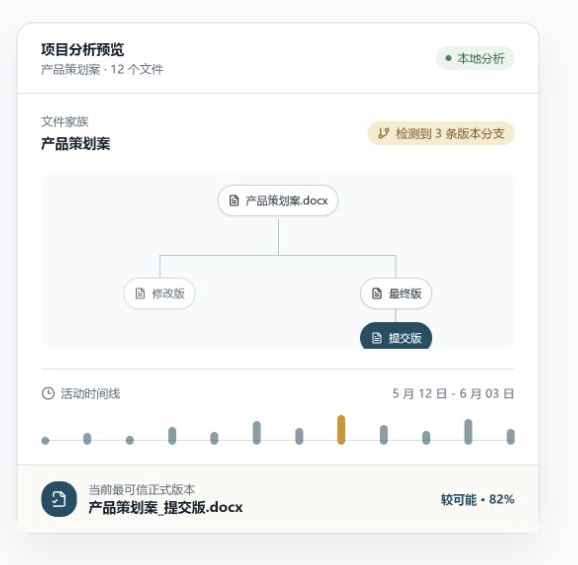

# Final-Final（文件考古学家）

<p align="center">
  
</p>

文件考古学家是一款本地运行、只读的桌面工具。它仅依据文件名、路径、扩展名、文件大小和时间信息，推测项目可能的版本演化，并始终将结论呈现为需要人工确认的推断。

当前 MVP 版本：`0.1.0`，首发平台为 Windows x64。

本项目不需要 API Key，不包含遥测、账号、云同步或外部 AI API。

## 当前状态

MVP 已完成只读扫描、文件名分析、文件家族聚类、版本关系图、项目时间线、六类风险检测、正式版本候选排名、项目报告、用户纠正、本地持久化与 PDF 导出。桌面应用支持目录选择、拖拽、扫描进度、取消和警告记录；扫描完成后进入包含总览、时间线、家族树、风险线索和文件调查档案的本地报告。每项推测都保留置信度与可展开证据。

用户可设置主版本、标记废弃或副本、设置父版本、删除推测边、拆分或合并家族，并撤销、重做或重新计算。纠正只改变报告，随后写入 Electron `userData` 中固定的 JSON 状态文件；不会在被调查的项目目录内写入内容。

报告可通过系统保存对话框导出为 A4 PDF，包含封面、项目摘要、正式版本候选、时间线、风险、文件家族摘要和推断限制。PDF 在本机由 Electron 生成；除用户明确选择的导出位置外，不会写入其他用户目录。

## 隐私原则

- 不读取 DOCX、PDF、PPTX 或其他文件的正文。
- 不上传文件或元数据，不调用外部 AI API。
- 不修改、移动、重命名、覆盖或删除原始文件。
- 仅在用户确认系统保存对话框后，向所选位置写入导出的 PDF。
- 后续扫描能力只通过 Electron preload 的白名单 IPC 暴露给 Renderer。
- 所有历史、关系与正式版本候选均为推测结果，应由用户人工确认。

完整说明见 [PRIVACY.md](./PRIVACY.md)。

## 界面预览




## Windows 安装

从 GitHub Release 下载 `Final-Final-0.1.0-x64.exe` 并运行。安装器支持选择安装目录，并创建开始菜单与桌面快捷方式。

当前版本没有代码签名证书，Windows 可能显示“未知发布者”或 SmartScreen 提示。请只使用本仓库 Release 工作流生成的安装包，并在需要时核对文件来源。

## 技术栈

Electron、Electron Vite、React、TypeScript、Tailwind CSS、shadcn/ui 结构、Zustand、React Router、React Flow、Apache ECharts、Vitest、React Testing Library、ESLint、Prettier 与 Electron Builder。

## 环境要求

- Node.js 22 或更高版本
- pnpm 11.9 或更高版本
- Windows 10/11（MVP 首发目标）

仓库使用 hoisted 依赖布局，以兼容不支持符号链接的 Windows/exFAT 工作区。

项目不需要 API Key。可参考 `.env.example`；当前阶段没有运行时环境变量。

## 本地开发

```bash
pnpm install
pnpm run dev
```

## 演示 Fixture

```bash
pnpm run fixture:demo
```

随后在桌面应用中选择 `fixtures/demo-project/`。该目录包含两个文件家族以及用于演示分支、多个正式版本、旧分支复活和跨目录副本的确定性元数据。示例文件正文只是固定长度的占位文本，应用不会读取它们。

## 质量检查

```bash
pnpm run lint
pnpm run typecheck
pnpm run test
pnpm run test:fixture
pnpm run test:pdf
pnpm run build
```

Windows x64 安装包命令为 `pnpm run dist:win`，产物写入 `dist/`。

## 发布

`.github/workflows/release.yml` 只响应 `v*` 标签。工作流会在 Windows Runner 上完成 lint、类型检查、测试、构建和 NSIS x64 打包，然后上传安装器并创建 GitHub Release。

例如发布当前版本：

```bash
git tag v0.1.0
git push origin v0.1.0
```

## 参与贡献

欢迎通过 Issue 和 Pull Request 参与。开始前请阅读 [CONTRIBUTING.md](./CONTRIBUTING.md) 和 [CODE_OF_CONDUCT.md](./CODE_OF_CONDUCT.md)。安全问题请遵循 [SECURITY.md](./SECURITY.md)，不要在公开 Issue 中披露敏感细节。

版本变化记录见 [CHANGELOG.md](./CHANGELOG.md)。

第三方依赖许可与 Apache ECharts NOTICE 见 [THIRD_PARTY_NOTICES.md](./THIRD_PARTY_NOTICES.md)。

## 架构

- `frontend/`：React Renderer、页面、组件、样式、HTML 入口与前端测试。
- `frontend/src/store/project.store.ts`：最近一次扫描基线、报告、纠正历史与异步保存状态。
- `backend/main.ts`：Electron 生命周期和安全窗口配置。
- `backend/preload.ts`：Renderer 与系统能力之间的最小白名单边界。
- `backend/scanner`：只读取目录项和文件元数据的递归扫描器。
- `backend/analysis`：纯函数文件名标准化、信号提取与相似度评分，不访问文件正文。
- `backend/clustering`：候选阻塞、保守评分、Union-Find 与文件家族摘要。
- `backend/inference`：版本方向、五项边评分、主/备选父边、环防护与图谱序列化。
- `backend/timeline`：日活动聚合与六类项目事件检测。
- `backend/risks`：六类可解释风险规则与人工确认建议。
- `backend/ranking`：正式版本候选评分、惩罚、Top 3 与置信度措辞。
- `backend/overrides`：用户纠正校验、基线重放、家族/版本图重建与候选覆盖。
- `backend/persistence`：固定写入 Electron `userData` 的最近项目 JSON 状态。
- `backend/report`：由结构化分析结果生成打印友好的有界 HTML，并通过 Electron 导出 PDF。
- `backend/ipc`：目录授权、扫描、进度、取消与 PDF 导出的白名单 IPC。
- `backend/security`：已授权根目录与路径边界检查。
- `docs/decisions`：范围与实现歧义的决策记录。

根目录仅保留前后端共享的构建配置、依赖清单和项目文档。

Renderer 使用 `contextIsolation: true`、`nodeIntegration: false` 和 `sandbox: true`，无法直接访问 Node.js 或文件系统。

扫描目录必须先经过系统目录选择器或真实拖拽授权。扫描器默认忽略版本控制目录、依赖、构建产物、缓存和临时文件，不跟随符号链接，最多读取 20,000 个文件与 20 层目录。

## 推断限制

文件元数据不能证明真实版本关系。文件名中的“最终”“定稿”或“提交”只能作为弱证据，应用不得将推测表达为事实。

## Roadmap

1. 只读目录选择、扫描、进度、取消与限制。
2. 文件名标准化与相似度分析（已完成）。
3. 文件家族、版本图、项目时间线与六类风险检测（已完成）。
4. 正式版本候选 Top 3 与可解释排名（已完成）。
5. 项目报告总览、时间线、家族、风险与文件档案（已完成）。
6. 用户纠正与本地 JSON 持久化（已完成）。
7. PDF 导出（已完成）。
8. Windows x64 打包发布（已完成）。

当前 MVP 明确不包含正文解析、自动整理、云同步、账号系统、LLM 或外部 AI API。

## License

本项目采用 OSI 批准的 [MIT License](./LICENSE)。允许使用、复制、修改和分发，但软件按“原样”提供，不附带任何保证。
